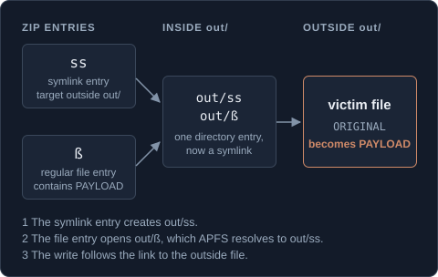

# CVE-2026-13723: arbitrary file overwrite in app-builder ZIP extraction

**Tomás Illuminati**, Cyber Security Researcher & Threat Intelligence Analyst

---

I tested a ZIP against Develar app-builder v4.2.0 in October 2026. `zipx.Unzip` returned without an error, but a file beside the output directory had changed from `ORIGINAL` to `PAYLOAD`. Its path appeared in the archive as a symlink target, never as a ZIP entry name. CERT/CC published the issue as [VU#293714](https://kb.cert.org/vuls/id/293714), and it is tracked as [CVE-2026-13723](https://www.cve.org/CVERecord?id=CVE-2026-13723).

The CVE record lists affected versions through 4.2.0. My checks used the [v4.2.0 tag](https://github.com/develar/app-builder/tree/v4.2.0). I haven't tested every version in that range.

---

## The archive

Two entries do the work. The first is a symlink named `ss`. Its stored target is the absolute path of a temporary file outside `out/`. The second is a regular file named `ß` that contains `PAYLOAD`. They're separate names in the ZIP. On the case-insensitive APFS volume I used, they refer to the same directory entry.

[Unicode's full case-folding data](https://www.unicode.org/Public/17.0.0/ucd/CaseFolding.txt) maps `ß` to `ss`. The PoC checks whether those two names actually alias on the local volume before extracting the archive. The [node-tar write-up](../CVE-2026-23950/README.md#two-names-one-file) explains that aliasing in more detail. node-tar had a table meant to keep two colliding entries apart. This extractor checks each entry's path on its own.

I put 300 one-byte entries between them to give the symlink time to appear. `zipx.Unzip` [schedules file extraction concurrently](https://github.com/develar/app-builder/blob/0bc38fb5e76c38ab24e36acf7a17887370e31fb4/pkg/archive/zipx/unzip.go#L68-L106), so their order in the ZIP doesn't guarantee which write finishes first.

## Where the write goes

<p align="center">
  
</p>

For each ZIP entry, [`computeExtractPath`](https://github.com/develar/app-builder/blob/0bc38fb5e76c38ab24e36acf7a17887370e31fb4/pkg/archive/zipx/unzip.go#L201-L209) joins its name to the output directory and checks the string prefix:

```go
filePath := filepath.Join(t.outputDir, zipFile.Name)
if strings.HasPrefix(filePath, t.outputDir) {
    return filePath, nil
}
```

Both `out/ss` and `out/ß` pass that check. At this point, the check has seen two path strings under `out/`. It hasn't followed a link or looked at a symlink target. The [symlink handler](https://github.com/develar/app-builder/blob/0bc38fb5e76c38ab24e36acf7a17887370e31fb4/pkg/archive/zipx/unzip.go#L252-L259) creates `out/ss` using the target stored in the ZIP without checking where it leads. In the successful runs, that link existed by the time the regular `ß` file was opened. On the tested volume, the lookup for `out/ß` reached the same symlink.

The [file writer](https://github.com/develar/app-builder/blob/0bc38fb5e76c38ab24e36acf7a17887370e31fb4/pkg/fs/file.go#L43-L80) opens that path like this:

```go
flag := os.O_WRONLY|os.O_CREATE|os.O_TRUNC
file, err := os.OpenFile(name, flag, 0666)
```

There's no `O_NOFOLLOW` flag. The open follows the symlink to the outside file, `O_TRUNC` empties it, and `io.CopyBuffer` writes the regular entry's bytes there. That's how `PAYLOAD` ends up outside `out/`. The same write can also happen with two entries that have byte-identical names. Unicode isn't required for it. What Unicode adds is two distinct spellings for the same APFS entry.

## Reproducing it

The [PoC](poc/poc.go) creates the ZIP, output directory, and victim file in a temporary directory. Its [Go module](poc/go.mod) pins app-builder to the v4.2.0 commit. It takes no destination path and stops before extraction if `ss` and `ß` don't alias on the local volume.

From the repository root on macOS:

```sh
cd CVE-2026-13723/poc
go run .
```

A successful run prints:

```text
victim before: ORIGINAL
victim after: PAYLOAD
```

Across ten local runs in October 2026, this padded ZIP changed the outside file every time on v4.2.0. The 300 intervening entries affect scheduling, so the count describes this archive and host. With the same ZIP against [PR #163 at `39853c6`](https://github.com/develar/app-builder/commit/39853c69a14a927e5e96f97c7a3e7a05ad1b73e1), the outside file stayed intact in ten runs. A benign ZIP extracted under both revisions. These checks called `zipx.Unzip` directly. I did not run a full Electron build.

## Impact and status

An application has to feed an attacker-controlled ZIP to this routine, and the build process needs permission to write the chosen outside file. When both hold, the archive can overwrite that file. Any further effect depends on what the file was. The [CERT/CC note](https://kb.cert.org/vuls/id/293714) classifies it as CWE-22 and CWE-59.

app-builder reaches many projects as a transitive dependency of electron-builder. Electron-Userland added a mitigation on its side.

I opened [PR #163](https://github.com/develar/app-builder/pull/163) as a reference fix. It rejects symlink targets outside the output directory and adds `O_NOFOLLOW` to regular-file opens. It was still open on November 15, 2026, and the CVE record did not list a fixed release. The CERT/CC note has no statement from Develar. Apple's status in the note is not affected.

## Disclosure

[CERT/CC's note](https://kb.cert.org/vuls/id/293714) and the CVE became public on July 29, 2026. Thanks to CERT/CC and Laurie Tyzenhaus for coordinating the case, and to Electron-Userland for its downstream mitigation. The PoC uses temporary files only.

---

## Timeline

- May 27, 2026: CERT/CC notified Develar.
- June 9, 2026: CERT/CC notified Apple.
- June 16, 2026: Apple's statement, not affected.
- June 29, 2026: CVE reserved.
- July 8, 2026: PR #163 opened.
- July 29, 2026: VU#293714 and the CVE published.
- November 15, 2026: PR #163 is open.

## References

- [CERT/CC vulnerability note VU#293714](https://kb.cert.org/vuls/id/293714)
- [CVE Program record](https://www.cve.org/CVERecord?id=CVE-2026-13723)
- [NIST NVD entry](https://nvd.nist.gov/vuln/detail/CVE-2026-13723)
- [app-builder v4.2.0 ZIP extractor](https://github.com/develar/app-builder/blob/0bc38fb5e76c38ab24e36acf7a17887370e31fb4/pkg/archive/zipx/unzip.go)
- [app-builder v4.2.0 file writer](https://github.com/develar/app-builder/blob/0bc38fb5e76c38ab24e36acf7a17887370e31fb4/pkg/fs/file.go)
- [Proposed fix, PR #163](https://github.com/develar/app-builder/pull/163)
