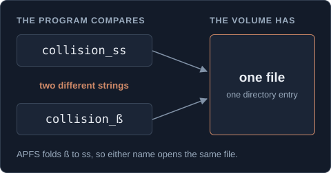
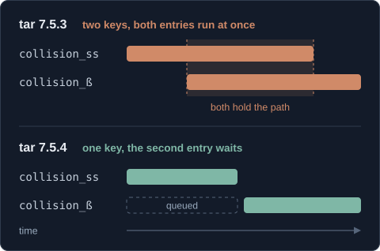

# CVE-2026-23950: colliding path reservations in node-tar

**Tomás Illuminati**, Cyber Security Researcher & Threat Intelligence Analyst

---

node-tar extracts archive entries in parallel, and a reservation table is supposed to keep two operations off the same path. I reserved collision_ss and collision_ß in tar 7.5.3 and both callbacks ran at once, although my APFS volume treats the two names as one file. Version 7.5.4 runs them one after the other.

---

## Two names, one file

A program that guards a path has to decide when two names mean the same file. Most of them compare the names as strings. The volume makes its own decision when the file is opened, and on macOS the two answers can differ.

<p align="center">
  
</p>

APFS treats names as equal in two ways that a string comparison misses.

| Kind | Example | Defined in |
| --- | --- | --- |
| Canonical equivalence | é stored as U+00E9 (NFC), or as e followed by U+0301 (NFD) | [Unicode Standard Annex #15](https://unicode.org/reports/tr15/) |
| Case folding | ß and ss, the fi ligature (U+FB01) and fi, A and a | [Unicode CaseFolding.txt](https://www.unicode.org/Public/17.0.0/ucd/CaseFolding.txt) |

Apple's [APFS guide](https://developer.apple.com/library/archive/documentation/FileManagement/Conceptual/APFS_Guide/FAQ/FAQ.html) says a file can be found under any normalization variant of its name on every APFS volume. Case folding applies on the case-insensitive variant, which is the default on macOS.

So a check that is keyed on the name can be passed by using the other spelling. In node-tar that check is the reservation table.

## What happens in node-tar

`PathReservations` builds one key per path and queues any operation whose key is already held. In 7.5.3 the key was the path after canonical decomposition (NFD) and one lowercase conversion. That handles é. It doesn't handle ß, because neither step maps ß to ss. The two spellings got different keys while the volume folded them into one name.

<p align="center">
  
</p>

The [vendor advisory](https://github.com/isaacs/node-tar/security/advisories/GHSA-r6q2-hw4h-h46w) describes what follows from that. When one of the colliding entries is a symlink, the race can redirect the other entry's write. Whether the write lands depends on the archive, on scheduling, and on what the extracting process is allowed to write.

## What you need

- A case-insensitive APFS volume, the macOS default. Both scripts stop if collision_ss and collision_ß aren't the same file there.
- Node.js and npm. I used Node.js 26.7.0 on macOS 27.2.1.

An application is exposed when it extracts an attacker-supplied tar archive with node-tar 7.5.3 or earlier.

## Running the two scripts

From the repository root:

```sh
cd CVE-2026-23950/poc
npm ci
npm run advisory
npm run check
```

The package file installs tar 7.5.3 and 7.5.4 side by side under two aliases.

The first script follows the [proof of concept published in the advisory](https://github.com/isaacs/node-tar/security/advisories/GHSA-r6q2-hw4h-h46w#poc). It builds a tar stream with two regular entries, collision_ss and collision_ß, and extracts it into a temporary directory with each version:

```text
7.5.3: directory_entries=1 aliases_same_inode=true
7.5.4: directory_entries=1 aliases_same_inode=true
```

One directory entry under both names confirms the alias on this volume. The output is the same for both versions, so this script can't tell them apart.

The second script can. It loads each release's own `PathReservations` class, reserves the two spellings, and counts how many callbacks are running before the first one releases:

```text
7.5.3: alias_peak=2 exact_peak=1
7.5.4: alias_peak=1 exact_peak=1
```

A peak of 2 means both entries held the path at once, which is the top half of the second diagram. The exact column reserves one spelling twice as a control and is 1 in both versions.

## Scope

Both scripts work inside a temporary directory and test the ß and ss pair from the advisory on tar 7.5.3 and 7.5.4. They show that the two entries hold the path at the same moment. They don't race a symlink, so they say nothing about how often the redirected write succeeds.

One detail for readers comparing the fix with the advisory. The key shipped in [7.5.4](https://github.com/isaacs/node-tar/blob/v7.5.4/src/normalize-unicode.ts) is NFD followed by a lowercase and an uppercase conversion pinned to the English locale. The advisory's remediation text suggests NFKD.

## Fix and disclosure

Fixed in tar 7.5.4. I reported the issue privately to the maintainer, and the CVE was published on January 20, 2026, with a CVSS 3.1 score of 8.8. For applications that can't upgrade, the advisory recommends filtering symlink entries out of untrusted archives.

---

## Timeline

- January 16, 2026: tar 7.5.3 released, the last affected version.
- January 19, 2026: CVE reserved and tar 7.5.4 released with the fix.
- January 20, 2026: CVE published.

## References

- [node-tar security advisory](https://github.com/isaacs/node-tar/security/advisories/GHSA-r6q2-hw4h-h46w)
- [CVE record](https://www.cve.org/CVERecord?id=CVE-2026-23950)
- [Reservation source in 7.5.3](https://github.com/isaacs/node-tar/blob/v7.5.3/src/path-reservations.ts)
- [Key normalization in 7.5.4](https://github.com/isaacs/node-tar/blob/v7.5.4/src/normalize-unicode.ts)
- [Unicode Standard Annex #15, Unicode Normalization Forms](https://unicode.org/reports/tr15/)
- [Unicode CaseFolding.txt, version 17.0.0](https://www.unicode.org/Public/17.0.0/ucd/CaseFolding.txt)
- [Apple File System Guide, frequently asked questions](https://developer.apple.com/library/archive/documentation/FileManagement/Conceptual/APFS_Guide/FAQ/FAQ.html)
