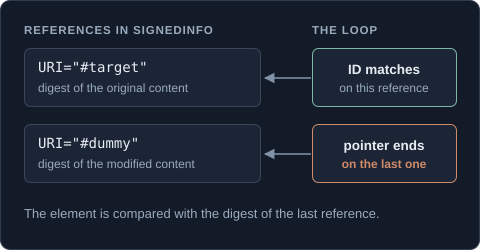

# CVE-2026-33487: XML signature verification bypass in goxmldsig

**Tomás Illuminati**, Cyber Security Researcher & Threat Intelligence Analyst

---

goxmldsig validates XML digital signatures in Go, and SAML libraries build on it. I signed an element, changed its text, and added a second reference to the signature. Version 1.5.0 accepted the changed element as validly signed. The validator had picked the wrong reference because of a loop variable. Fixed in 1.6.0.

---

## Root cause

A signature's SignedInfo block lists references, and each one carries the digest of one element. `validateSignature` walks the list to find the reference for the element it is checking. This is the loop in [1.5.0](https://github.com/russellhaering/goxmldsig/blob/v1.5.0/validate.go#L309-L313):

```go
for _, _ref := range signedInfo.References {
	if _ref.URI == "" || _ref.URI[1:] == idAttr {
		ref = &_ref
	}
}
```

It stores the address of the loop variable. Before Go 1.22 that variable is one slot for the whole loop, so after the loop the pointer holds whatever the last iteration put there. It doesn't matter which reference matched. The digest that gets compared is always the last one in the list.

<p align="center">
  
</p>

So the document needs two references. The first one matches the element's ID and holds the digest of the original content. The second one points at an ID that isn't in the document and holds the digest of the changed content. The match happens on the first, the comparison uses the second, and the changed content passes.

The Go version that counts is the library's own. goxmldsig 1.5.0 declares `go 1.21.0` in its go.mod, and Go keeps the old loop semantics for a module that declares a version below 1.22. That holds even when the application is built with a current toolchain. I built with Go 1.27.0 and the bug was there.

## What you need

- Go 1.25 or later. I used Go 1.27.0 on macOS 27.2.1.

The person who builds the document also needs a way to get a valid signature over the SignedInfo block that carries both references. In the check that's a throwaway key generated in memory. Against a real deployment it depends on who signs and what they are willing to sign.

## Running the check

From this directory:

```sh
cd poc
go run . -expect vulnerable
go run -modfile=go.fixed.mod . -expect fixed
```

The two module files pin goxmldsig 1.5.0 and 1.6.0. The program follows the [proof of concept in the advisory](https://github.com/russellhaering/goxmldsig/security/advisories/GHSA-479m-364c-43vc). It creates a key and a certificate in memory, builds the document with two references, re-signs SignedInfo, and validates the result. It writes no files.

With 1.5.0:

```text
control: untouched document accepted=true
modified document accepted=true
validated text: "Modified Content"
```

With 1.6.0:

```text
control: untouched document accepted=true
modified document accepted=false
validation error: Signature could not be verified
```

The control signs and validates an untouched element. It has to be accepted in both runs.

## Scope

The check uses an enveloped RSA signature with the library's default settings and one pair of references. It shows that 1.5.0 accepts content whose digest was never compared. It doesn't test a SAML library on top of goxmldsig, where the outcome also depends on how the caller uses the validated element.

## Fix and disclosure

I reported the issue privately to the maintainer. [1.6.0](https://github.com/russellhaering/goxmldsig/releases/tag/v1.6.0) indexes the slice, takes the address of the element, and stops at the first match. It also raises the minimum Go version to 1.23. The CVE has a CVSS 3.1 score of 7.5.

---

## Timeline

- March 18, 2026: goxmldsig 1.6.0 released and the advisory published.
- March 20, 2026: CVE reserved.
- March 26, 2026: CVE published.

## References

- [goxmldsig security advisory](https://github.com/russellhaering/goxmldsig/security/advisories/GHSA-479m-364c-43vc)
- [CVE record](https://www.cve.org/CVERecord?id=CVE-2026-33487)
- [NIST NVD entry](https://nvd.nist.gov/vuln/detail/CVE-2026-33487)
- [validate.go in 1.5.0](https://github.com/russellhaering/goxmldsig/blob/v1.5.0/validate.go#L309-L313)
- [goxmldsig 1.6.0 release notes](https://github.com/russellhaering/goxmldsig/releases/tag/v1.6.0)
- [Go 1.22 loop variable change](https://go.dev/blog/loopvar-preview)
- [CWE-347, improper verification of cryptographic signature](https://cwe.mitre.org/data/definitions/347.html)
