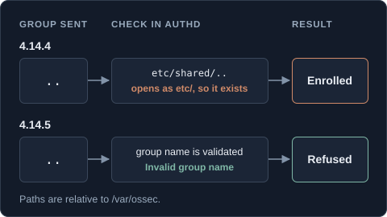

# CVE-2026-39359: path traversal in Wazuh authd through the agent group name

**Tomás Illuminati**, Cyber Security Researcher & Threat Intelligence Analyst

---

A Wazuh agent picks its group when it enrolls. I enrolled an agent with the group `..` on a 4.14.4 manager, with no credentials, and the manager accepted it and issued a key. The enrollment daemon only checked that the group's directory existed, and `..` under the shared folder is the folder above it, the one that holds the manager's keys and configuration. Fixed in 4.10.4 and 4.14.5, which refuse the name.

---

## Root cause

authd validates each requested group in [auth.c](https://github.com/wazuh/wazuh/blob/v4.14.4/src/os_auth/auth.c#L408-L417):

```c
snprintf(dir, PATH_MAX + 1, SHAREDCFG_DIR "/%s", group);
dp = wopendir(dir);
if (!dp) {
    merror("Invalid group: %.255s", group);
    ...
```

The group name goes into a path and the path is opened. If the directory opens, the group is valid. With the group `..` the path is /var/ossec/etc/shared/.., which opens as /var/ossec/etc.

<p align="center">
  
</p>

The [advisory](https://github.com/wazuh/wazuh/security/advisories/GHSA-6q95-fcwc-4h44) describes the second half. remoted builds the files it sends to an agent from the directory of each group the agent belongs to, with the same kind of path. For the group `..` that directory is /var/ossec/etc, where client.keys, ossec.conf, and the manager's certificate and key live. Enrollment needs no authentication by default, which is why the CVE is rated as unauthenticated.

## What you need

- Docker, to run a throwaway manager. I used Docker 29.7.2 on macOS 27.2.1.
- Python 3 for the check script.

A deployment is exposed when authd is reachable by an untrusted host and enrollment has no password or certificate check. That's the default configuration.

## Running the check

Start one manager per version, bound to loopback:

```sh
docker run -d --name wazuh-vulnerable -p 127.0.0.1:15151:1515 wazuh/wazuh-manager:4.14.4
docker run -d --name wazuh-fixed -p 127.0.0.1:15152:1515 wazuh/wazuh-manager:4.14.5
```

Give them about a minute to start. Then, from the repository root:

```sh
cd CVE-2026-39359/poc
python3 check.py --port 15151 --expect vulnerable
python3 check.py --port 15152 --expect fixed
```

The script follows the [proof of concept in the advisory](https://github.com/wazuh/wazuh/security/advisories/GHSA-6q95-fcwc-4h44). It sends one enrollment request for the group `..,default` and one for the plain `default` group as a control. It refuses to run against anything but a loopback address.

With 4.14.4:

```text
control: group=default accepted=True
crafted: group=..,default accepted=True
```

With 4.14.5:

```text
control: group=default accepted=True
crafted: group=..,default accepted=False
manager reply: ERROR: Invalid group name: ... Unable to add agent
```

Remove the containers when you're done:

```sh
docker rm -f wazuh-vulnerable wazuh-fixed
```

## What the agent receives

The check covers enrollment, which is the part this CVE's fix changes. What the manager then sends to the agent depends on the release, so I ran the full chain with a real agent on three of them.

| Manager and agent | authd accepts `..` | Agent receives files from /var/ossec/etc |
| --- | --- | --- |
| 4.3.11 | Yes | Yes, the manager's client.keys |
| 4.13.1 | Yes | No |
| 4.14.4 | Yes | No |
| 4.14.5 | No | No, enrollment is refused |

For 4.3.11 I installed the official manager and agent packages in two Debian 12 containers on an internal Docker network. I put a marker file in the manager's /var/ossec/etc and enrolled the agent in `..,default`.

remoted built a shared directory for that pair of groups under var/multigroups and copied /var/ossec/etc into it. Its merged.mg, the bundle that goes to the agent, listed client.keys, ossec.conf, internal_options.conf, the local rules and decoders, and my marker. The copy on the agent held the manager's client.keys, with the same SHA-256 as the original.

Two limits showed up in that run. The transfer stopped at 876,544 of 2,737,414 bytes, with remoted logging "Error creating encrypted message", so ossec.conf and the marker didn't reach the agent. And sslmanager.key and sslmanager.cert are readable by root only, so remoted never put them in the bundle.

In 4.13.1 and 4.14.4 the chain stops earlier. authd issues the key and the agent connects, but wazuh-db logs "Invalid group name. '..' represents the parent directory" and stores no membership, so remoted builds nothing for the agent. That check is in [wdb_global.c](https://github.com/wazuh/wazuh/blob/v4.4.0/src/wazuh_db/wdb_global.c#L1333) from 4.4.0 on. I didn't run the releases between 4.4.0 and 4.13.1.

## Fix and disclosure

I reported the issue privately to Wazuh. The fix shipped in 4.14.5 and in 4.10.4 for the older line. authd now checks the name itself and rejects forbidden characters and directory references before it opens anything. The advisory was published on July 16, 2026, with a CVSS 3.1 score of 7.5.

---

## Timeline

- April 6, 2026: CVE reserved.
- April 23, 2026: Wazuh 4.14.5 released with the fix.
- July 16, 2026: advisory and CVE published.
- July 30, 2026: Wazuh 4.10.4 released with the fix.

## References

- [Wazuh security advisory](https://github.com/wazuh/wazuh/security/advisories/GHSA-6q95-fcwc-4h44)
- [CVE record](https://www.cve.org/CVERecord?id=CVE-2026-39359)
- [NIST NVD entry](https://nvd.nist.gov/vuln/detail/CVE-2026-39359)
- [auth.c in Wazuh 4.14.4](https://github.com/wazuh/wazuh/blob/v4.14.4/src/os_auth/auth.c#L408-L417)
- [The group name check in wazuh-db, 4.4.0](https://github.com/wazuh/wazuh/blob/v4.4.0/src/wazuh_db/wdb_global.c#L1333)
- [CWE-22, path traversal](https://cwe.mitre.org/data/definitions/22.html)
