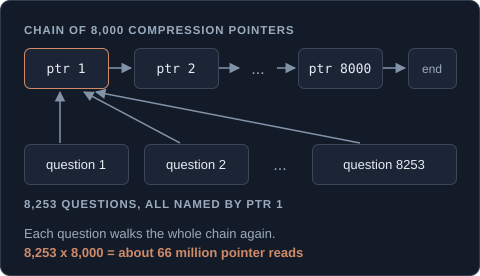

# CVE-2026-42304: denial of service in Twisted DNS name decompression

**Tomás Illuminati**, Cyber Security Researcher & Threat Intelligence Analyst

---

One DNS message over TCP kept a Twisted DNS server busy for 2.7 seconds on my machine. Twisted runs on a single thread, so for those seconds the process answered nothing else. The message was 65,533 bytes of compression pointers and questions. Fixed in Twisted 26.4.0rc2, which parses the same message in under a millisecond.

---

## Root cause

DNS lets a name point at an earlier offset in the message instead of repeating it. `Name.decode` in twisted.names follows those pointers. Since 2011 it has kept a set of visited offsets so that a loop raises an error. This is the part that matters in [25.5.0](https://github.com/twisted/twisted/blob/twisted-25.5.0/src/twisted/names/dns.py#L595-L631):

```python
visited = set()
...
if (l >> 6) == 3:
    new_off = (l & 63) << 8 | ord(readPrecisely(strio, 1))
    if new_off in visited:
        raise ValueError("Compression loop in encoded name")
    visited.add(new_off)
```

Two things are missing. There is no limit on how many pointers one name may follow, and the visited set starts empty for every name. A long chain with no loop passes the check, and a second name that points into the same chain walks it again from the start.

<p align="center">
  
</p>

`DNSServerFactory` decodes every question that the header announces. So the message holds a chain of 8,000 pointers, each one pointing at the next, and then as many questions as fit in the rest. Every question is six bytes and names the head of the chain.

## What you need

- Python 3 with the venv module. I used Python 3.14.7 on macOS 27.2.1.

A server is exposed when it accepts DNS over TCP with twisted.names and an untrusted client can reach it. The message is too large for classic UDP.

## Running the check

From the repository root, create one temporary environment per version:

```sh
cd CVE-2026-42304
twisted_25_env="$(mktemp -d)"
twisted_26_env="$(mktemp -d)"
python3 -m venv "$twisted_25_env"
python3 -m venv "$twisted_26_env"
"$twisted_25_env/bin/python" -m pip install 'Twisted==25.5.0'
"$twisted_26_env/bin/python" -m pip install 'Twisted==26.4.0rc2'
"$twisted_25_env/bin/python" poc/check.py --expect vulnerable
"$twisted_26_env/bin/python" poc/check.py --expect fixed
```

The script follows the [proof of concept in the advisory](https://github.com/twisted/twisted/security/advisories/GHSA-grgv-6hw6-v9g4). It builds the message, hands it to a `DNSServerFactory` protocol through an in-memory transport, and times the call. It opens no socket.

```text
twisted=25.5.0 pointers=8000 questions=8253 control_seconds=0.004 crafted_seconds=2.706
twisted=26.4.0rc2 pointers=8000 questions=8253 control_seconds=0.005 crafted_seconds=0.000
```

The control is the same message shape with a chain of one pointer. It takes a few milliseconds in both versions. Remove the two environments when you're done.

## Scope

The time is from one machine, an Apple silicon laptop, and it will differ on other hardware. The check measures one message. A client that keeps sending them keeps the reactor busy for as long as it sends. I tested the server factory only. Other callers of `Name.decode` weren't tested.

## Fix and disclosure

I reported the issue privately to the Twisted maintainers. 26.4.0rc2 adds a counter that is shared by the whole message and stops decoding after 1,000 pointer jumps, with an error. The final 26.4.0 release followed on May 11, 2026. The CVE has a CVSS 3.1 score of 7.5.

---

## Timeline

- April 26, 2026: CVE reserved.
- April 29, 2026: Twisted 26.4.0rc2 released with the fix.
- May 5, 2026: advisory published.
- May 11, 2026: Twisted 26.4.0 released.
- May 13, 2026: CVE published.

## References

- [Twisted security advisory](https://github.com/twisted/twisted/security/advisories/GHSA-grgv-6hw6-v9g4)
- [CVE record](https://www.cve.org/CVERecord?id=CVE-2026-42304)
- [NIST NVD entry](https://nvd.nist.gov/vuln/detail/CVE-2026-42304)
- [Name.decode in Twisted 25.5.0](https://github.com/twisted/twisted/blob/twisted-25.5.0/src/twisted/names/dns.py#L595-L631)
- [The 2011 commit that added the visited set](https://github.com/twisted/twisted/commit/e11cd82bdd79b3ebbb0e8635cbb9c76df2b5af09)
- [RFC 9267, common implementation anti-patterns related to DNS resource record processing](https://datatracker.ietf.org/doc/html/rfc9267)
- [CWE-407, inefficient algorithmic complexity](https://cwe.mitre.org/data/definitions/407.html)
