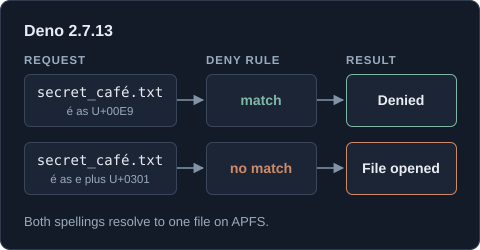

# CVE-2026-49401: Deno path permission bypass on macOS

**Tomás Illuminati**, Cyber Security Researcher & Threat Intelligence Analyst

---

I gave a Deno script read access to a directory and denied one file inside it. Asking for the file by the name in the deny rule failed, as it should. Asking for it with the é encoded the other way returned the contents. The write, run, and FFI deny rules gave way to the same trick. That was Deno 2.7.13 on macOS. Fixed in 2.7.14, which refuses every one of those requests.

---

## Why the deny rule misses

Deno checks permissions before it touches the filesystem, and the check compares path strings. APFS resolves names by equivalence, so a precomposed é (U+00E9) and an e followed by a combining accent (U+0065 U+0301) open one file. My deny rule had the first spelling and the request used the second. The strings differed, so nothing matched the deny rule and the broader allow rule applied.

  

For the background on APFS and equivalent names, see the [node-tar write-up](../CVE-2026-23950/README.md#two-names-one-file). The difference is what the comparison protects. In node-tar it orders two writes. In Deno it's the sandbox boundary, so the other spelling takes a script to a path the user had denied by name.

The [Deno advisory](https://github.com/denoland/deno/security/advisories/GHSA-8xpq-cjcf-3wh9) states that the deny rules for read, write, run, and FFI share this comparison. It also says Linux and Windows aren't affected by this variant.

## When it applies

- macOS on APFS.
- Deno 2.7.13 or earlier.
- Less-trusted code that runs with an allow permission and a path-specific deny rule.
- A denied path that has another spelling on the volume: an accented letter, ß, a Latin ligature, or a change of case.

## Results

Each test denied one path and allowed its directory. Then it made two requests, one by the name in the rule and one by another spelling of it. Both names resolved to one inode before every run. All files were temporary.

| Deny rule | Name in the rule | Name requested | Deno 2.7.13 | Deno 2.7.14 |
| --- | --- | --- | --- | --- |
| read | é as U+00E9 | e plus U+0301 | Returned the file | Denied |
| read | lowercase | uppercase | Returned the file | Denied |
| read | ß | ss | Returned the file | Denied |
| read | fi ligature (U+FB01) | fi | Returned the file | Denied |
| write | é as U+00E9 | e plus U+0301 | Overwrote the file | Denied |
| run | é as U+00E9 | e plus U+0301 | Ran the program | Denied |
| FFI | é as U+00E9 | e plus U+0301 | Loaded and called the library | Denied |

The request by the name in the rule was denied in every row on both versions. Each denial was a NotCapable error.

The maintainers asked that the full report and proof stay out of public release, so this page has no script. The advisory gives an equivalent example.

## Scope

The seven rows ran on macOS 27.2.1 with the release builds of Deno 2.7.13 and 2.7.14 for Apple silicon. They cover the four deny rules and the four kinds of spelling the advisory names. Operating-system file permissions sit below the Deno check and still apply to any request that gets past it.

## Fix and disclosure

Fixed in Deno 2.7.14. I reported the issue privately to the Deno team. The advisory went out on May 27, 2026, and the CVE on June 23. The vendor scores it 7.3 under CVSS 3.1 and NVD scores it 8.4. If you can't upgrade yet, use allow lists instead of deny lists, as the advisory recommends.

---

## Timeline

- April 28, 2026: Deno 2.7.14 released with the fix.
- May 27, 2026: advisory published.
- May 29, 2026: CVE reserved.
- June 23, 2026: CVE published.
- November 16, 2026: CERT/CC published VU#604762, which lists this CVE.

## References

- [Deno security advisory](https://github.com/denoland/deno/security/advisories/GHSA-8xpq-cjcf-3wh9)
- [CVE record](https://www.cve.org/CVERecord?id=CVE-2026-49401)
- [NIST NVD entry](https://nvd.nist.gov/vuln/detail/CVE-2026-49401)
- [CERT/CC vulnerability note VU#604762](https://kb.cert.org/vuls/id/604762)
